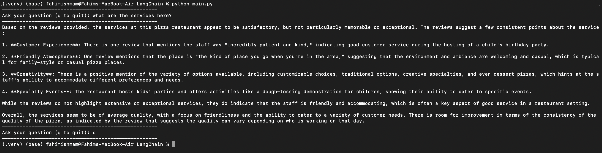
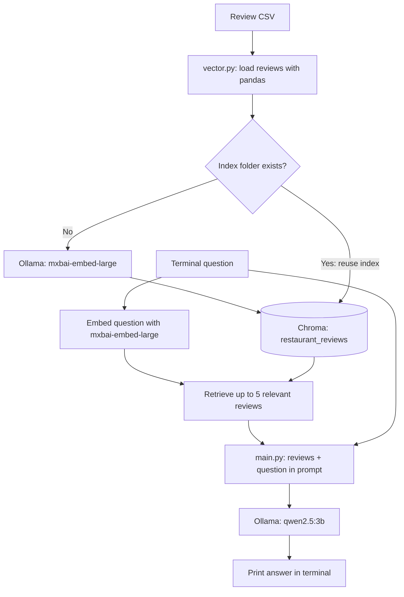
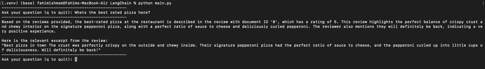
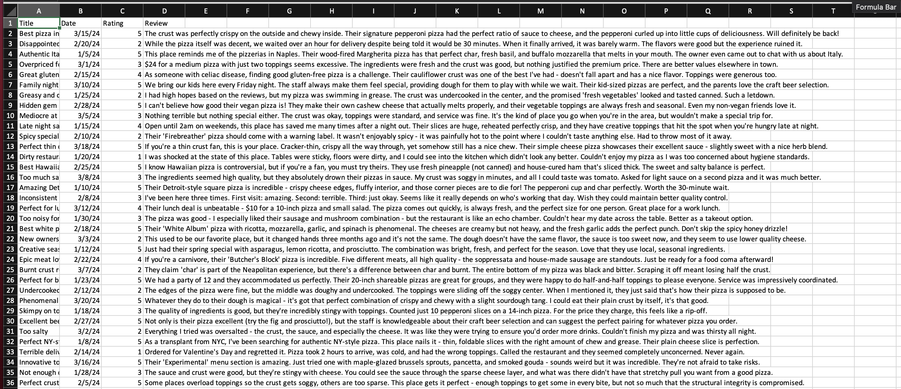

# Local Restaurant Review Chatbot

A local terminal chatbot for anyone exploring restaurant reviews or learning how to build retrieval-augmented generation (RAG) with LangChain.


**Project preview** — Review-based answer about restaurant service.


## Contents

- [Features](#features)
- [Architecture](#architecture)
- [Screenshots](#screenshots)
- [Tech stack](#tech-stack)
- [Run locally](#run-locally)
- [Usage](#usage)
- [Database requirements](#database-requirements)
- [Troubleshooting](#troubleshooting)
- [Limitations](#limitations)

## Features

**Ask about the restaurant**

- Ask questions about food, service, or value in a terminal.
- Get answers generated with up to five relevant customer reviews as context.

**Explore local RAG**

- Generate review embeddings through Ollama.
- Store the review index locally in Chroma and reuse it between runs.
- Run the language model locally without a cloud API key.

## Architecture

The project runs locally as a command-line app. Python calls the local Ollama API for embeddings and text generation. RAG supplies reviews to the prompt; it does not train the model on the dataset.



| File or directory | Responsibility |
| --- | --- |
| `main.py` | Reads questions, retrieves reviews, invokes the model, and prints answers |
| `vector.py` | Loads the CSV, configures embeddings, and creates the Chroma retriever |
| `realistic_restaurant_reviews.csv` | Source review text and metadata |
| `requirements.txt` | Python dependencies |
| `chroma_langchain_db/` | Generated, persistent local review index |

## Screenshots

**Asking about the best-rated pizza using customer reviews**



**Source review data**



## Tech stack

| Area | Technology |
| --- | --- |
| Language | Python; developed using Python 3.13 |
| Prompt and retrieval orchestration | LangChain |
| Local model runtime | Ollama via `langchain-ollama` |
| Text generation | `qwen2.5:3b` |
| Embeddings | `mxbai-embed-large` |
| Vector database | Chroma via `langchain-chroma` |
| CSV loading | pandas |
| User interface | Terminal input and output |

## Run locally

### Prerequisites

- Python with virtual environment support.
- [Ollama](https://ollama.com/) installed.
- Available memory and storage for both Ollama models.
- Internet access to download dependencies and models initially.

### 1. Clone the project

```bash
git clone https://github.com/Ishmam21/ChatBotLocal.git
cd ChatBotLocal
```

### 2. Create a virtual environment

These commands work in the regular macOS Terminal app as well as VS Code's terminal. Run them from the project directory. If `.venv` already exists, skip creating it and only activate it. It is a hidden directory; use `ls -a` to see it.

macOS / Linux:

```bash
python3 -m venv .venv
source .venv/bin/activate
```

Windows PowerShell:

```powershell
python -m venv .venv
.\.venv\Scripts\Activate.ps1
```

### 3. Install dependencies

```bash
python -m pip install -r requirements.txt
```

Install dependencies after activating `.venv`, so they are installed into the Python environment used by the app. Installation is needed during initial setup and when dependencies change, not every time you open Terminal.

### 4. Download and start the local models

```bash
ollama pull qwen2.5:3b
ollama pull mxbai-embed-large
```

Keep the Ollama app running. If using the command-line server instead, run this in a separate terminal only when a server is not already running:

```bash
ollama serve
```

### 5. Check the dataset and start the app

Keep `realistic_restaurant_reviews.csv` in the project root, then run from that directory:

```bash
python main.py
```

- The first run creates the review embeddings and `chroma_langchain_db/` before showing the question prompt.
- Later runs reuse the index.
- No `.env` file or cloud credentials are required by the current code. Keep any credentials you introduce later out of the repository.

### Returning to the project in macOS Terminal

After initial setup, open Terminal and run these commands for this local checkout:

```bash
cd "/Users/fahimishmam/Desktop/VS stuff/LangChain"
source .venv/bin/activate
python main.py
```

If your checkout is elsewhere, replace the `cd` path. Keep Ollama running. You only need to download the models once; you do need to activate `.venv` in each new terminal session.

If your prompt shows `(base)`, Conda's base environment is active. Activate `.venv` with the command above before running the app. To bypass shell activation entirely, you can use the project's Python directly:

```bash
.venv/bin/python -m pip install -r requirements.txt
.venv/bin/python main.py
```

The install command is only needed if dependencies are missing or have changed. After quitting the chatbot, run `deactivate` to leave an activated virtual environment.

## Usage

Enter a question at `Ask your question (q to quit):`, for example:

- How are the vegan options?
- What do customers say about the service?
- Is the pizza good value for money?

Type `q` to quit, or press **Ctrl+C** to interrupt the program. The complete answer prints after generation finishes.

## Database requirements

Chroma creates its local storage automatically. No manual SQL setup is required.

The source CSV must contain these exact column names:

| Column | Purpose |
| --- | --- |
| `Title` | Combined with the review body for embedding and retrieval |
| `Review` | Review body supplied as context to the model |
| `Rating` | Stored as document metadata under `rating` |
| `Date` | Stored as document metadata under `date` |

The Chroma collection is named `restaurant_reviews`. Each document uses its CSV row index as its ID.

**Refreshing the index:** Stop the app, move or delete `chroma_langchain_db/`, then restart. The current code checks whether the folder exists; it does not automatically detect CSV changes or an incomplete index. Keep the source CSV when rebuilding.

## Troubleshooting

| Problem | What to check |
| --- | --- |
| `ModuleNotFoundError: No module named 'langchain_ollama'` | From the project directory, run `source .venv/bin/activate`, then `python -m pip install -r requirements.txt`, then `python main.py`. If Python still uses the wrong environment, use the `.venv/bin/python` commands above. |
| CSV file not found | Run from the project root and confirm the full `.csv` filename |
| Ollama connection fails | Start the Ollama app or local server |
| Model not found | Run `ollama list` and confirm both required models are downloaded |
| Answers have no review context | An interrupted indexing run may have left an empty database; rebuild the index as described above |
| No output immediately | Initial indexing, model loading, and answer generation can take time; answers do not stream |

## Limitations

- Model answers can contain unsupported claims; check them against the source reviews.
- The prompt does not enforce source citations.
- Questions are processed independently, without conversation history.
- Dataset changes require an index rebuild.
- The current interface is a local terminal app; it does not expose its own HTTP API or hosted web interface.
